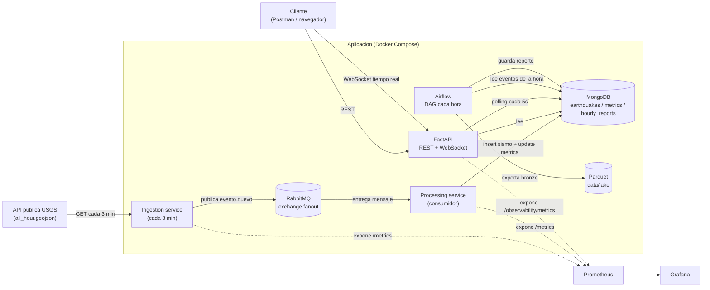
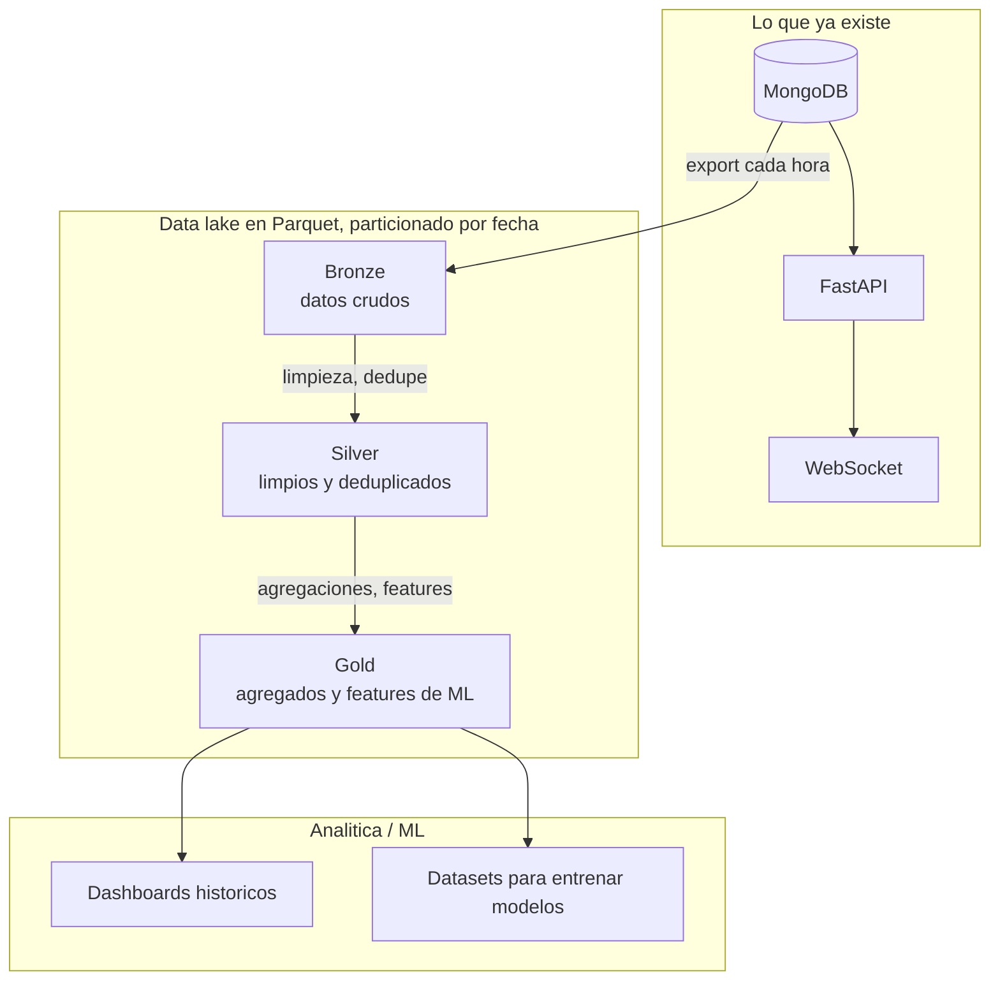

# Arquitectura

## Diagrama general

La idea de separar ingesta y procesamiento con RabbitMQ en el medio es que el
servicio de ingesta nunca toca MongoDB directamente. Solo habla con la API
externa (que puede fallar o estar lenta) y publica en la cola. Si el servicio
de procesamiento se cae un rato, los mensajes se quedan esperando en RabbitMQ
en vez de perderse, y la ingesta sigue funcionando sin verse afectada por un
problema de escritura en la base de datos.

## Por qué estas colecciones en Mongo

**earthquakes**: un documento por sismo. `event_id` tiene índice único — en
vez de revisar a mano si el sismo ya existe antes de guardarlo, simplemente
se intenta insertar y Mongo rechaza el duplicado. También hay índice en
`event_time` (casi toda consulta ordena o filtra por fecha) y en `magnitude`
(se usa para filtrar por rango).

**metrics**: un documento por hora (`"2026-06-17T10"`), que se actualiza con
operadores atómicos (`$inc`, `$max`) cada vez que llega un sismo nuevo, en
vez de recalcular todo desde cero cada vez. `window` también es único: una
hora, un solo documento.

**hourly_reports**: un documento por hora, generado por Airflow. `report_date`
es único para que si el DAG se vuelve a correr para la misma hora, actualice
el reporte en vez de duplicarlo.

¿Por qué Mongo y no una base relacional? Los datos no tienen relaciones
complejas entre sí (no hay joins), el volumen de escritura es bajo, pero las
lecturas desde la API necesitan ser rápidas y con filtros flexibles. Un
modelo de documentos con los índices correctos encaja mejor ahí que forzar un
esquema relacional rígido para algo que en el fondo son solo registros de
eventos.

## Por qué RabbitMQ y no Kafka

El volumen de sismos por hora a nivel mundial es bajo — nada que requiera el
throughput o el particionamiento de Kafka. RabbitMQ es más simple de levantar
(un solo contenedor) y el patrón que hace falta es sencillo: avisar a quien
esté escuchando que hay un sismo nuevo, que es justo para lo que sirve un
exchange tipo `fanout`.

## Una idea para escalar esto hacia analítica y Machine Learning

Esto es una propuesta de diseño, pero con algo concreto ya funcionando: en
cada corrida del DAG de Airflow, además de guardar el reporte en Mongo, se
exportan los sismos de esa hora a un archivo Parquet en
`data/lake/bronze/date=YYYY-MM-DD/hour=HH.parquet` (función
`export_events_to_parquet` en `src/services/reporting_service.py`).

La idea es que Mongo siga siendo la fuente de verdad para todo lo que
necesita ser rápido y reciente (la API y el WebSocket), pero que no se use
para análisis pesado sobre todo el histórico — eso termina saturando una base
pensada para transacciones. En vez de eso, los datos se van exportando a un
data lake en Parquet organizado en capas:

- **Bronze**: la copia cruda de lo que llegó, particionada por fecha (ya
  implementado).
- **Silver**: una versión limpia y sin duplicados, lista para consultarse con
  herramientas como DuckDB, Spark o Pandas.
- **Gold**: tablas ya agregadas para dashboards (sismos por región y día) y
  para armar datasets de entrenamiento — por ejemplo, features como "cuántos
  sismos hubo en la misma región en las últimas 24h" o la energía sísmica
  acumulada (`10^(1.5 * magnitud)`).

Los dashboards en tiempo real seguirían saliendo de Mongo (como ya pasa hoy),
mientras que los históricos y de tendencias saldrían de la capa Gold con
alguna herramienta de BI, refrescados por Airflow.

Con el tiempo, también tendría sentido mover de Mongo a Parquet (y borrar de
Mongo) los eventos más viejos que, digamos, 90 días, para que la base
operativa no crezca indefinidamente, dejando el histórico completo
disponible igual en el data lake.

No llegué a montar algo como Spark o MinIO para esto — el alcance de la
prueba no lo pide, y hacerlo sin un volumen real de datos que lo justifique
sería meter infraestructura de más. Preferí dejar la prueba de concepto
funcionando con lo mínimo (pandas y pyarrow, que ya estaban en el proyecto) y
documentar hacia dónde crecería si hiciera falta.
