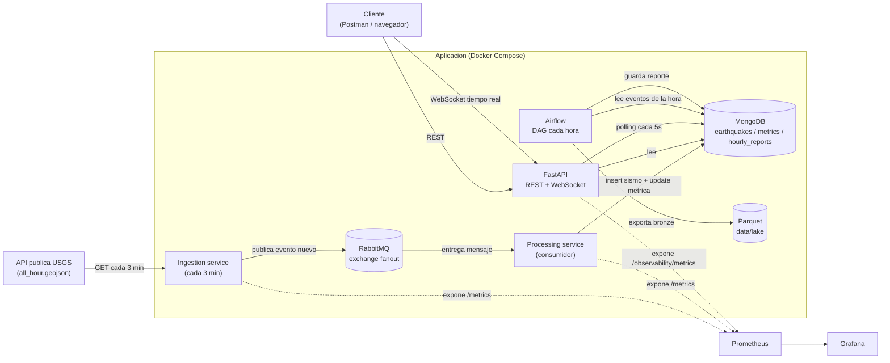

# Arquitectura

## Diagrama

Versión más visual, con puertos y colecciones: https://claude.ai/artifact/QaRdAcYsPYCfSNnTavVFHQ

La ingesta no toca Mongo directamente: solo habla con la API de USGS y publica en RabbitMQ. Si el servicio de procesamiento se cae un rato, los mensajes se quedan esperando en la cola en vez de perderse.

## Por qué estas colecciones en Mongo

- **earthquakes**: un documento por sismo. `event_id` tiene índice único — en vez de revisar a mano si ya existe, simplemente intento insertar y dejo que Mongo rechace el duplicado.
- **metrics**: un documento por hora, que se actualiza con `$inc`/`$max` cada vez que llega un sismo, en vez de recalcular todo desde cero.
- **hourly_reports**: un documento por hora. `report_date` es único para que si Airflow reintenta, actualice el reporte en vez de duplicarlo.

Elegí Mongo porque los datos no tienen relaciones complejas entre sí, el volumen de escritura es bajo, y las lecturas desde la API necesitan ser rápidas y con filtros flexibles — un esquema relacional rígido no aportaba mucho aquí.

## Por qué RabbitMQ y no Kafka

El volumen es bajo (sismos por hora a nivel mundial, no miles de mensajes por segundo), así que no necesito el throughput de Kafka. RabbitMQ es más simple de levantar, y el patrón que hace falta — avisar a quien esté escuchando que hay un sismo nuevo — es justo para lo que sirve un exchange `fanout`.

## Cómo escalaría esto hacia analítica y Machine Learning

Ya tengo una prueba real funcionando: cada corrida del DAG exporta los sismos de esa hora a un Parquet en `data/lake/bronze/` (función `export_events_to_parquet`).

La idea completa sería separar Mongo (rápido, para la API y el WebSocket) de un data lake en capas — bronze (crudo), silver (limpio y sin duplicados), gold (agregados y features para ML) — para que el análisis histórico pesado no termine saturando la base operativa. Los dashboards en tiempo real seguirían saliendo de Mongo; los históricos, de la capa gold con alguna herramienta de BI, refrescados por Airflow. Con el tiempo también archivaría de Mongo a Parquet los eventos más viejos que, digamos, 90 días, para que la base no crezca indefinidamente.

No monté algo como Spark o MinIO para esto: el alcance de la prueba no lo pedía, y hacerlo sin un volumen real de datos que lo justifique sería meter infraestructura de más.
