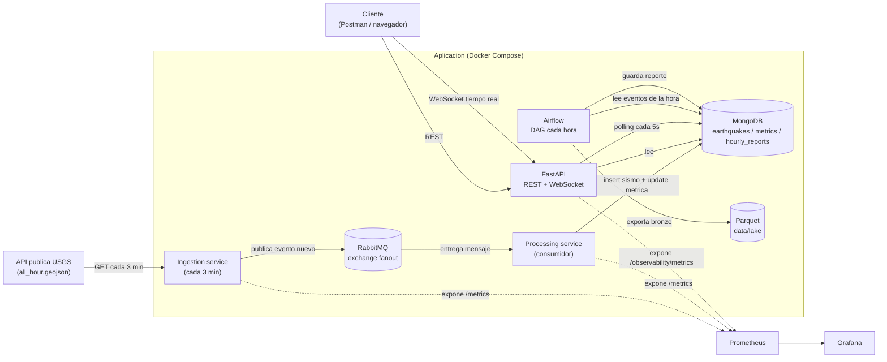

# Arquitectura

## 1. Diagrama general



**Por que esta forma de desacoplar:** el servicio de ingesta **no** escribe
directamente en MongoDB. Solo se encarga de hablar con la API externa (que
puede fallar, estar lenta, etc.) y publicar en RabbitMQ. Si el servicio de
procesamiento estuviera caído, los mensajes quedan esperando en la cola en
vez de perderse, y la ingesta puede seguir funcionando sin que un problema de
escritura en base de datos la bloquee. Esto es justamente lo que pide el
enunciado con "principios de diseño desacoplado" y corresponde al bonus
Nivel 3 (procesamiento orientado a eventos).

## 2. Decisiones de modelado de datos (MongoDB)

### Coleccion `earthquakes`
Un documento por sismo, tal como llega transformado desde USGS. Se eligio
`event_id` como **indice unico** en vez de manejar la deduplicacion "a mano"
en el codigo: es mas simple y mas seguro (aunque dos procesos intenten
insertar el mismo sismo al mismo tiempo, Mongo solo deja pasar uno).

Indices creados (`src/database/indexes.py`):
- `event_id` (unique) — evita duplicados.
- `event_time` — la mayoria de consultas ordenan o filtran por fecha.
- `magnitude` — se usa mucho para filtrar por rango de magnitud.

### Coleccion `metrics`
Un documento por ventana de hora (ej. `"2026-06-17T10"`), que se va
actualizando con operadores atomicos (`$inc`, `$max`) cada vez que llega un
sismo nuevo, en vez de recalcular todo desde cero. Esto hace que la
actualizacion sea O(1) sin importar cuantos sismos tenga esa hora.
`window` tiene indice unico porque solo debe existir un documento por hora.

### Coleccion `hourly_reports`
Un documento por hora generado por Airflow. `report_date` es unico: si el
DAG se vuelve a ejecutar para la misma hora (por ejemplo, un reintento),
actualiza el reporte existente en vez de crear uno duplicado (`upsert`).

### Por que MongoDB y no otra base
Los datos son documentos semi-estructurados que se leen mucho mas de lo que
se relacionan entre si (no hay joins complejos), y el volumen de escritura es
bajo (un sismo nuevo cada tanto), pero las lecturas de la API necesitan ser
rapidas y flexibles en los filtros. Eso encaja bien con un modelo de
documentos con los indices correctos, sin necesitar el overhead de un
esquema relacional rigido.

## 3. Por que RabbitMQ y no Kafka

El enunciado permite elegir entre Kafka, RabbitMQ, WebSockets o
procesamiento orientado a eventos (Nivel 3). Se eligio **RabbitMQ** porque:
- El volumen de eventos es bajo (sismos por hora a nivel mundial, no miles
  de mensajes por segundo), asi que no se necesita el particionamiento ni el
  throughput de Kafka.
- Es mas simple de operar (un solo contenedor, sin Zookeeper/KRaft) y mas
  facil de entender para este alcance.
- El patron que se necesita es simple: "avisar a quien este escuchando que
  hay un sismo nuevo", que es exactamente para lo que sirve un exchange tipo
  `fanout`.

## 4. Nivel 4 — Arquitectura de datos para analitica avanzada y Machine Learning

Esta seccion es una **propuesta de diseño** (como pide el enunciado), con una
prueba de concepto real ya implementada: en cada corrida del DAG de Airflow,
ademas de guardar el reporte en Mongo, se exportan los eventos crudos de esa
hora a un archivo Parquet en `data/lake/bronze/date=YYYY-MM-DD/hour=HH.parquet`
(ver `export_events_to_parquet` en `src/services/reporting_service.py`).

### 4.1. Arquitectura propuesta: separar la capa transaccional de la analitica

```mermaid
flowchart TB
    subgraph OLTP["Capa transaccional (hoy)"]
        M[("MongoDB")]
        A["FastAPI"]
        WS["WebSocket"]
    end

    subgraph LAKE["Data Lake (Parquet, particionado por fecha)"]
        BRONZE["Bronze\ndatos crudos"]
        SILVER["Silver\nlimpios y deduplicados"]
        GOLD["Gold\nagregados y features de ML"]
    end

    subgraph BI["Analitica / ML"]
        HIST["Dashboards historicos\n(Grafana/Metabase + DuckDB)"]
        ML["Datasets de entrenamiento\npara modelos de ML"]
    end

    M -->|export incremental\n(Airflow, hoy cada hora)| BRONZE
    BRONZE -->|limpieza, dedupe| SILVER
    SILVER -->|agregaciones, features| GOLD
    GOLD --> HIST
    GOLD --> ML
    M --> A --> WS
```

**Idea central:** MongoDB sigue siendo la fuente de verdad para todo lo que
necesita ser **rapido y reciente** (la API REST y el WebSocket), pero no se
usa para analisis pesado sobre datos historicos — eso satura una base de
datos pensada para transacciones. En su lugar, los datos se exportan de forma
incremental (near real-time, ej. cada hora u cada pocos minutos) a un data
lake en formato Parquet, organizado en capas:

- **Bronze**: copia cruda de lo que llego, particionada por fecha/hora (lo
  que ya esta implementado en este proyecto).
- **Silver**: version limpia, validada contra el mismo modelo `EarthquakeEvent`
  y sin duplicados, lista para consultarse con herramientas analiticas
  (DuckDB, Spark, Pandas).
- **Gold**: tablas agregadas listas para dashboards (ej. sismos por region
  por dia) y para generar **datasets de entrenamiento** de Machine Learning
  (ej. features como "sismos en las ultimas 24h en la misma region",
  "energia sismica acumulada" usando la formula `10^(1.5 * magnitud)`, etc.).

### 4.2. Dashboards

- **Tiempo real**: se sirven directamente desde MongoDB/`metrics` a traves de
  la API y el WebSocket (lo que ya existe hoy) — necesitan datos frescos al
  segundo, no agregaciones pesadas sobre todo el historico.
- **Historicos / tendencias**: se sirven desde la capa Gold del data lake con
  una herramienta de BI (Grafana con datasource de DuckDB/Postgres, o
  Metabase), refrescados por un DAG de Airflow (por ejemplo, una vez al dia).

### 4.3. Volumen de datos historicos

A medida que la coleccion `earthquakes` de Mongo crece, se recomienda:
- Un **indice TTL** o un job periodico que archive (mueva a Parquet) y borre
  de Mongo los eventos mas viejos que, por ejemplo, 90 dias — MongoDB queda
  liviano y rapido para lo operativo, y el historico completo sigue
  disponible en el data lake para analisis.
- Particionar los archivos Parquet por fecha (como ya se hace) para que las
  consultas analiticas por rango de fechas no tengan que leer archivos que no
  necesitan.

### 4.4. Por que no se implemento con Spark/MinIO/Trino en este entregable

El alcance de esta prueba tecnica no pide desplegar esa infraestructura, y
hacerlo sin un volumen real de datos que lo justifique seria sobre-ingenieria.
Se opto por demostrar el concepto (exportacion a Parquet, particionado por
fecha) con herramientas minimas (pandas/pyarrow) que ya estan en el proyecto,
dejando documentada la ruta de crecimiento hacia una arquitectura de
analitica/ML mas completa si el volumen de datos lo llegara a requerir.
